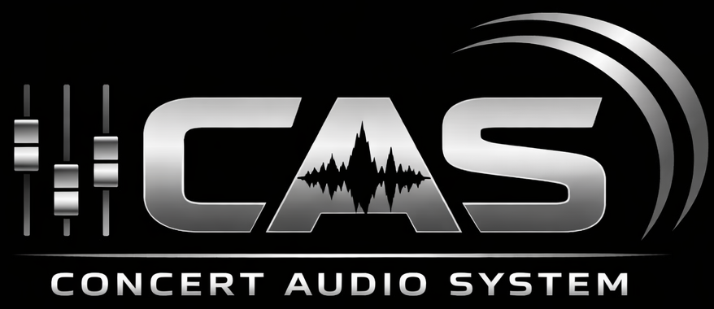
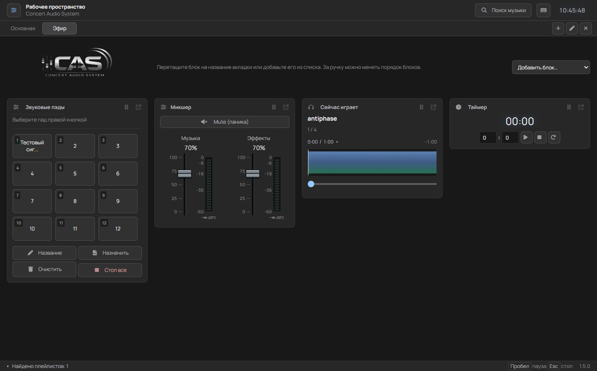

  

<h1 align="center">Звук вашего мероприятия под контролем</h1>

  <strong>Concert Audio System</strong> — приложение для звукового сопровождения концертов, 
  спектаклей и живых мероприятий. Музыка, эффекты и управление эфиром в одном окне.

  <a href="https://cas.rexcorp.space/"><strong>Сайт CAS</strong></a> ·
  <a href="https://github.com/IliaBebebe/Concert-Audio-System/releases/latest"><strong>Скачать приложение</strong></a> ·
  <a href="https://github.com/IliaBebebe/Concert-Audio-System/issues">Сообщить об ошибке</a>

  
  

---

## Для сцены, пульта и прямого эфира

В [CAS 1.6](https://github.com/IliaBebebe/Concert-Audio-System/releases/tag/v1.6.0) обновлены запуск и установщик, добавлены шкалы с делениями времени и единые иконки всех платформ. В простое и при сворачивании меньше фоновой визуальной работы; музыка и переходы продолжаются.

CAS помогает подготовить музыкальную программу, вовремя запустить отбивку и держать громкость под рукой. Подходит звукорежиссёрам, ведущим, театральным командам и организаторам событий.

Загрузите локальные плейлисты, назначьте эффекты на пэды и соберите рабочее пространство под своё мероприятие. Локальные файлы и уже сохранённые записи доступны без интернета.

## Возможности

| Инструмент | Что можно делать |
| :--- | :--- |
| **Две деки A / B** | Подготовить следующий плейлист, пока играет текущий; настроить кроссфейд внутри плейлиста и между деками. |
| **Плейлисты и очередь** | Загружать музыку из папок, менять порядок треков перетаскиванием и выбирать режим воспроизведения. |
| **12 звуковых пэдов** | Назначать джинглы, отбивки и эффекты, запускать их мышью или горячими клавишами. |
| **Микшер и контроль уровня** | Отдельно регулировать музыку и эффекты, следить за пиковыми индикаторами dBFS и быстро включать Mute. |
| **Рабочие вкладки** | Создавать до 12 вкладок, переносить блоки и сохранять их расположение. Переключение вкладок не прерывает звук. |
| **Поиск музыки** | Искать записи YouTube или вставлять ссылки YouTube / YouTube Music, готовить их для выбранной деки и сохранять локально. |
| **Контроль воспроизведения** | Видеть текущий трек, время и осциллограмму; использовать историю, таймер и блокировку интерфейса. |
| **Сохранение настроек** | Восстанавливать плейлисты, порядок треков, назначения пэдов и рабочие вкладки после перезапуска без автоматического старта музыки. |

### Рабочее пространство CAS 1.5

*Соберите на отдельной вкладке инструменты, которые нужны прямо сейчас.*

## Скачать и установить

Готовые сборки доступны на [сайте CAS](https://cas.rexcorp.space/) и в [последнем стабильном релизе](https://github.com/IliaBebebe/Concert-Audio-System/releases/latest).

| Платформа | Скачать | Установка |
| :--- | :--- | :--- |
| **Windows 10 / 11 · x64** | [Установщик .exe](https://github.com/IliaBebebe/Concert-Audio-System/releases/latest/download/Concert-Audio-System-Setup.exe) | Запустите установщик и следуйте его шагам. |
| **macOS · Intel и Apple Silicon** | [Универсальный .dmg](https://github.com/IliaBebebe/Concert-Audio-System/releases/latest/download/Concert-Audio-System-macOS.dmg) | Откройте образ и перетащите CAS в «Программы». |
| **Linux · x64** | [AppImage](https://github.com/IliaBebebe/Concert-Audio-System/releases/latest/download/Concert-Audio-System-linux.AppImage) · [Пакет .deb](https://github.com/IliaBebebe/Concert-Audio-System/releases/latest/download/Concert-Audio-System-linux.deb) | Разрешите запуск AppImage или установите .deb в Debian / Ubuntu. |

### Предупреждение Windows при скачивании или установке

При скачивании или первом запуске CAS Windows может показать сообщение «Система Windows защитила ваш компьютер», «Неизвестный издатель» или предупреждение о редко скачиваемом файле. Установщик CAS 1.6.0 пока не имеет цифровой подписи издателя. SmartScreen учитывает подпись и репутацию конкретного файла, поэтому новые сборки могут вызывать такое предупреждение. [Подробнее о проверке репутации — в документации Microsoft](https://learn.microsoft.com/ru-ru/windows/apps/package-and-deploy/smartscreen-reputation).

Предупреждение о неизвестном приложении само по себе не означает, что найден вирус. Перед продолжением проверьте источник: скачивайте CAS с [официального сайта](https://cas.rexcorp.space/) или из [релизов этого репозитория](https://github.com/IliaBebebe/Concert-Audio-System/releases). Сайт ведёт на те же файлы GitHub. Исходный код и [процесс сборки](https://github.com/IliaBebebe/Concert-Audio-System/actions/workflows/release.yml) открыты для проверки.

Если файл получен из официального источника и сообщение касается неизвестного приложения или редких скачиваний:

1. **При скачивании в Microsoft Edge:** откройте меню `⋯` рядом с файлом → **«Сохранить»** → **«Показать больше»** → **«Всё равно сохранить»**. Формулировки могут немного отличаться в зависимости от версии браузера. [Инструкция Microsoft](https://learn.microsoft.com/ru-ru/deployedge/microsoft-edge-security-smartscreen).
2. **При запуске установщика:** в окне «Система Windows защитила ваш компьютер» нажмите **«Подробнее»**, проверьте имя `Concert-Audio-System-Setup.exe` и выберите **«Выполнить в любом случае»**.
3. Следуйте шагам установщика. Отключать Defender, SmartScreen или добавлять папку в исключения для этого не требуется.

**Если Defender сообщает об обнаруженном вирусе, трояне или другой угрозе**, не разрешайте файл и не восстанавливайте его из карантина. [Сообщите нам](https://github.com/IliaBebebe/Concert-Audio-System/issues), приложив версию CAS, ссылку загрузки и точное название угрозы или скриншот. Если кнопки продолжения нет либо запуск заблокирован Smart App Control или правилами организации, обратитесь к администратору или напишите нам; до уточнения причины не пытайтесь обходить блокировку.

## Быстрый старт

1. Установите CAS для своей системы и выберите папку с музыкой.
2. Загрузите плейлист в деку A, а следующую подборку подготовьте в деке B.
3. Назначьте нужные эффекты на 12 пэдов и настройте громкость музыки и эффектов.
4. При необходимости создайте отдельные вкладки для репетиции, эфира или разных частей программы.
5. Запустите трек и управляйте программой мышью или с клавиатуры.

### Музыка из YouTube

Поиск и первая подготовка записи требуют интернета. Текущая музыка продолжает играть во время подготовки; сохранённые записи затем доступны локально. Поддерживаются отдельные записи длительностью до 30 минут, без входа в аккаунт. Доступность зависит от сети и ограничений YouTube. Используйте материалы, которые разрешено скачивать и воспроизводить.

## Горячие клавиши

| Клавиша | Действие |
| :--- | :--- |
| **Пробел** | Пауза / продолжить воспроизведение |
| **Shift + A / Shift + B** | Выбрать целевую деку A / B |
| **← / →** | Предыдущий / следующий трек |
| **↑ / ↓** | Громкость музыки |
| **Shift + ↑ / ↓** | Громкость эффектов |
| **1–9, 0, −, =** | Запустить звуковые пэды 1–12 |
| **Alt + ↑ / ↓** | Переместить выбранный трек в очереди |
| **Esc** | Остановить все звуки |
| **M** | Mute — быстрое отключение звука |
| **L** | Заблокировать / разблокировать интерфейс |
| **Tab / Shift + Tab** | Перейти к следующему / предыдущему элементу интерфейса |

При фокусе на кнопке пробел нажимает эту кнопку. Для перестановки трека фокус должен быть на его строке, а поиск — очищен. Назначение и переименование пэда доступны через правую кнопку мыши или фокус с клавиатуры.

## Обратная связь и исходники

Нашли ошибку или хотите предложить улучшение? [Создайте issue](https://github.com/IliaBebebe/Concert-Audio-System/issues) и укажите версию CAS, операционную систему и шаги для воспроизведения.

Описание выше относится к стабильному CAS 1.6. Исходники этой версии доступны в [теге v1.6.0](https://github.com/IliaBebebe/Concert-Audio-System/tree/v1.6.0); основная ветка может отличаться от опубликованной сборки. Приложение построено на Electron и Howler.js.

  <a href="https://cas.rexcorp.space/"><strong>cas.rexcorp.space</strong></a> 
  Concert Audio System · REX Corp

